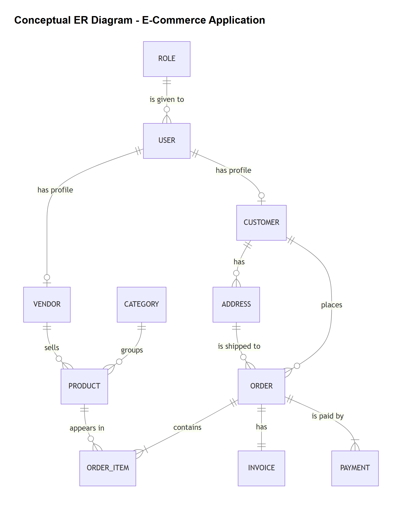

# Conceptual Schema - E-Commerce Application

## 1. Introduction

This document shows the conceptual schema of our e-commerce application.

The conceptual schema is the first step of the database design. Here we only describe
the main "things" the store needs to remember (entities), what information we keep about
each one (attributes), and how they are connected (relationships).

We do not include primary keys, foreign keys or data types yet. Those will be added in
the logical schema and in the SQL Server implementation.

## 2. Entities

| Entity | What it represents |
|---|---|
| User | An account used to log in to the application |
| Role | The type of user: ADMIN, VENDOR or CUSTOMER |
| Vendor | A company that sells products in the store |
| Customer | A person who buys products |
| Address | A shipping address of a customer |
| Category | A group of products (for example Electronics or Books) |
| Product | An item that is sold in the store |
| Order | A purchase made by a customer |
| OrderItem | One line of an order (which product and how many) |
| Invoice | The bill created when an order is completed |
| Payment | The money paid for an order |

The project asks for at least Product, Vendor, Customer, Order, OrderItem, Invoice and
Payment. We added User, Role, Category and Address because we need them for the login,
to organize the products and to know where to ship the orders.

## 3. Attributes

Attributes marked with (unique) cannot be repeated between two records. For example, two
users cannot have the same email.

| Entity | Attributes |
|---|---|
| User | username (unique), email (unique), password, enabled |
| Role | name (unique) |
| Vendor | company name (unique), phone, active |
| Customer | first name, last name, phone |
| Address | street, city, province, postal code, country |
| Category | name (unique), description |
| Product | SKU (unique), name, description, price, quantity in stock, status |
| Order | order date, status, total |
| OrderItem | quantity, unit price |
| Invoice | invoice number (unique), issue date, total |
| Payment | payment method, amount, payment date |

Notes:
- The email is only stored in User, so it is not repeated in Vendor or Customer.
- The password will never be saved as plain text. It will be saved encrypted (hashed).
- The product status (IN_STOCK or OUT_OF_STOCK) depends on the quantity in stock.
- The order total is calculated from the order items (quantity x unit price).

## 4. Relationships

| Relationship | Type | Explanation |
|---|---|---|
| Role - User | One to many | A role can be given to many users. Each user has only one role. |
| User - Vendor | One to one (optional) | A vendor has one user account to log in. |
| User - Customer | One to one (optional) | A customer has one user account to log in. An admin is a user with no vendor or customer profile. |
| Vendor - Product | One to many | A vendor can sell many products. Each product belongs to one vendor. |
| Category - Product | One to many | A category has many products. Each product is in one category. |
| Customer - Address | One to many | A customer can save many addresses. Each address belongs to one customer. |
| Customer - Order | One to many | A customer can make many orders. Each order belongs to one customer. |
| Address - Order | One to many | Each order is sent to one address. The same address can be used for many orders. |
| Order - OrderItem | One to many | An order has one or more items. Each item belongs to one order. |
| Product - OrderItem | One to many | A product can appear in many order items. Each item is about one product. |
| Order - Invoice | One to one | Each order has one invoice and each invoice belongs to one order. |
| Order - Payment | One to many | An order can be paid with one or more payments. Each payment belongs to one order. |

### Why is the Order - Invoice relationship one to one?

In our application a purchase is saved completely or not at all. So every order that
exists in the database was completed and always has its invoice.

## 5. ER Diagram

### How to read the diagram

The diagram uses the crow's foot notation. The symbol at the end of each line tells how
many records can be connected:

| Symbol | Meaning |
|---|---|
| Two lines | Exactly one |
| Circle and line | Zero or one |
| Line and crow's foot | One or many |
| Circle and crow's foot | Zero or many |

For example, between CUSTOMER and ORDER: on the customer side there are two lines, so each
order belongs to exactly one customer. On the order side there is a circle and a crow's
foot, so a customer can have zero or many orders (a new customer has not bought anything yet).

## 6. Business Rules

1. The price of a product must be greater than 0.
2. The quantity in stock cannot be negative.
3. When the quantity of a product is 0, its status is OUT_OF_STOCK. Otherwise it is IN_STOCK.
4. Usernames, emails, company names, category names, SKUs and invoice numbers cannot be repeated.
5. An order must have at least one item, and the quantity of each item must be more than 0.
6. A customer can only buy a product if there is enough stock and the vendor is active.
7. An order can only be shipped to an address of the same customer.
8. The payment must cover the total of the order. If not, the purchase is rejected.
9. A purchase is all or nothing. The order, the items, the stock update, the invoice and
   the payment are saved together. If one step fails, nothing is saved (rollback).
10. Two customers cannot buy the last unit of the same product at the same time.
11. The payment method can be CREDIT_CARD or BANK_TRANSFER.
12. Only an ADMIN can activate or deactivate a vendor.
13. Prices and totals use exact decimal numbers (not float or double).
