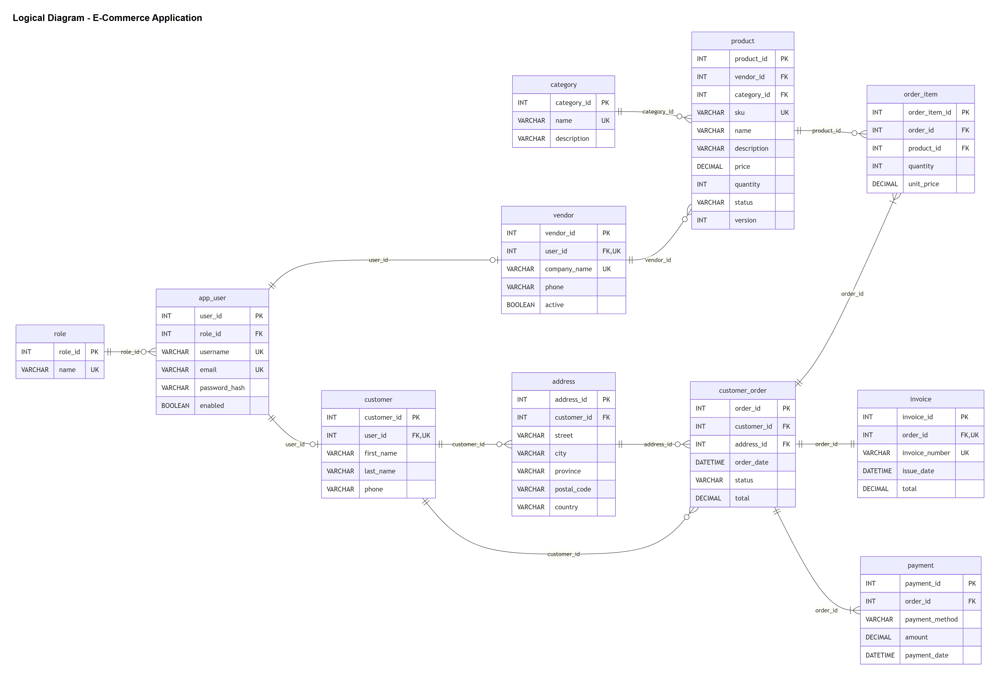

# Logical Schema - E-Commerce Application

## 1. Introduction

This document shows the logical schema of our e-commerce application.

In the conceptual schema we described the entities, their attributes and how they are
related. In the logical schema we turn each entity into a table and we add:

- A primary key (PK) to identify each row.
- Foreign keys (FK) to connect the tables.
- A general data type for each column.
- The rules of each column (required, unique, allowed values).

We still do not write SQL code here. The SQL Server code will be in the physical
implementation.

## 2. From Entities to Tables

Each entity of the conceptual schema becomes one table. Two names had to change because
USER and ORDER are reserved words in SQL, so they would cause problems in the queries:

| Entity | Table |
|---|---|
| Role | role |
| User | app_user |
| Vendor | vendor |
| Customer | customer |
| Address | address |
| Category | category |
| Product | product |
| Order | customer_order |
| OrderItem | order_item |
| Invoice | invoice |
| Payment | payment |

Every table has its own primary key called `<table>_id`. It is a number that the database
creates automatically (1, 2, 3...).

To connect two tables in a one to many relationship, we put the primary key of the "one"
side as a foreign key in the "many" side. For example, one customer has many orders, so
the table customer_order has the column customer_id.

## 3. Tables

Legend: PK = primary key, FK = foreign key, UK = unique key. "Required" means the column
cannot be empty (NOT NULL).

### role

| Column | Type | Key | Required | Notes |
|---|---|---|---|---|
| role_id | INT | PK | Yes | |
| name | VARCHAR(20) | UK | Yes | ADMIN, VENDOR or CUSTOMER |

This table keeps the three types of users of the application. We use it to decide what each user is allowed to do. For example, only a user with the role ADMIN can activate or deactivate vendors.

### app_user

| Column | Type | Key | Required | Notes |
|---|---|---|---|---|
| user_id | INT | PK | Yes | |
| role_id | INT | FK | Yes | References role |
| username | VARCHAR(50) | UK | Yes | |
| email | VARCHAR(100) | UK | Yes | |
| password_hash | VARCHAR(255) | | Yes | The encrypted password, never the real one |
| enabled | BOOLEAN | | Yes | Default true |

This table keeps the login information of every person who uses the application. Each user has one role through role_id. The password is saved as a hash, so even if someone sees the table, they cannot know the real password.

### vendor

| Column | Type | Key | Required | Notes |
|---|---|---|---|---|
| vendor_id | INT | PK | Yes | |
| user_id | INT | FK, UK | Yes | References app_user. Unique, so one user has only one vendor profile |
| company_name | VARCHAR(100) | UK | Yes | |
| phone | VARCHAR(20) | | No | |
| active | BOOLEAN | | Yes | Default true. The admin can deactivate a vendor |

This table keeps the information of the companies that sell in the store. It is connected to app_user so the vendor can log in. The column active lets the admin turn off a vendor without deleting it.

### customer

| Column | Type | Key | Required | Notes |
|---|---|---|---|---|
| customer_id | INT | PK | Yes | |
| user_id | INT | FK, UK | Yes | References app_user. Unique, so one user has only one customer profile |
| first_name | VARCHAR(50) | | Yes | |
| last_name | VARCHAR(50) | | Yes | |
| phone | VARCHAR(20) | | No | |

This table keeps the personal information of the people who buy in the store. It is connected to app_user so the customer can log in. The email is not here because it is already in app_user.

### address

| Column | Type | Key | Required | Notes |
|---|---|---|---|---|
| address_id | INT | PK | Yes | |
| customer_id | INT | FK | Yes | References customer |
| street | VARCHAR(150) | | Yes | |
| city | VARCHAR(80) | | Yes | |
| province | VARCHAR(50) | | Yes | |
| postal_code | VARCHAR(10) | | Yes | |
| country | VARCHAR(50) | | Yes | |

This table keeps the shipping addresses of the customers. A customer can have many addresses (for example home and work), so each address has the customer_id of its owner.

### category

| Column | Type | Key | Required | Notes |
|---|---|---|---|---|
| category_id | INT | PK | Yes | |
| name | VARCHAR(50) | UK | Yes | |
| description | VARCHAR(255) | | No | |

This table keeps the groups used to organize the products, like Electronics or Books. It helps the customer find products more easily.

### product

| Column | Type | Key | Required | Notes |
|---|---|---|---|---|
| product_id | INT | PK | Yes | |
| vendor_id | INT | FK | Yes | References vendor |
| category_id | INT | FK | Yes | References category |
| sku | VARCHAR(30) | UK | Yes | Product code |
| name | VARCHAR(100) | | Yes | |
| description | VARCHAR(500) | | No | |
| price | DECIMAL(10,2) | | Yes | Must be greater than 0 |
| quantity | INT | | Yes | Stock. Must be 0 or more |
| status | VARCHAR(20) | | Yes | IN_STOCK or OUT_OF_STOCK |
| version | INT | | Yes | Default 0. Used to stop two customers from buying the last unit at the same time |

This table keeps the items that are sold in the store. Each product belongs to one vendor and one category. The quantity is the stock, and the status changes to OUT_OF_STOCK when the quantity is 0. The column version changes every time the product is updated, so if two customers try to buy the last unit at the same time, only the first one can do it.

### customer_order

| Column | Type | Key | Required | Notes |
|---|---|---|---|---|
| order_id | INT | PK | Yes | |
| customer_id | INT | FK | Yes | References customer |
| address_id | INT | FK | Yes | References address (where the order is shipped) |
| order_date | DATETIME | | Yes | Default current date and time |
| status | VARCHAR(20) | | Yes | PAID, SHIPPED, DELIVERED or CANCELLED |
| total | DECIMAL(12,2) | | Yes | Must be greater than 0 |

This table keeps the purchases. Each order belongs to one customer and is sent to one address. The total is the sum of all the items of the order.

### order_item

| Column | Type | Key | Required | Notes |
|---|---|---|---|---|
| order_item_id | INT | PK | Yes | |
| order_id | INT | FK | Yes | References customer_order |
| product_id | INT | FK | Yes | References product |
| quantity | INT | | Yes | Must be greater than 0 |
| unit_price | DECIMAL(10,2) | | Yes | Price at the moment of the purchase. Must be greater than 0 |

This table keeps the lines of each order: which product was bought and how many. It connects customer_order and product, so it solves the many to many relationship between them. The unit_price is copied from the product at the moment of the purchase, so old orders do not change if the price changes later. The pair (order_id, product_id) is unique, so the same product cannot appear twice in the same order; we increase the quantity instead.

### invoice

| Column | Type | Key | Required | Notes |
|---|---|---|---|---|
| invoice_id | INT | PK | Yes | |
| order_id | INT | FK, UK | Yes | References customer_order. Unique, so one order has only one invoice |
| invoice_number | VARCHAR(30) | UK | Yes | For example INV-2026-00001 |
| issue_date | DATETIME | | Yes | Default current date and time |
| total | DECIMAL(12,2) | | Yes | Must be greater than 0 |

This table keeps the bill of each order. It is created at the same time as the order. Because order_id is unique, one order can only have one invoice.

### payment

| Column | Type | Key | Required | Notes |
|---|---|---|---|---|
| payment_id | INT | PK | Yes | |
| order_id | INT | FK | Yes | References customer_order |
| payment_method | VARCHAR(20) | | Yes | CREDIT_CARD or BANK_TRANSFER |
| amount | DECIMAL(12,2) | | Yes | Must be greater than 0 |
| payment_date | DATETIME | | Yes | Default current date and time |

This table keeps the payments of each order and the method used (credit card or bank transfer). We do not save card numbers or bank account numbers. They are only checked when the payment is processed, because saving them would be a security risk.

## 4. Relationships (Foreign Keys)

| Relationship | Type | Foreign key | References |
|---|---|---|---|
| Role - User | One to many | app_user.role_id | role.role_id |
| User - Vendor | One to one | vendor.user_id (unique) | app_user.user_id |
| User - Customer | One to one | customer.user_id (unique) | app_user.user_id |
| Vendor - Product | One to many | product.vendor_id | vendor.vendor_id |
| Category - Product | One to many | product.category_id | category.category_id |
| Customer - Address | One to many | address.customer_id | customer.customer_id |
| Customer - Order | One to many | customer_order.customer_id | customer.customer_id |
| Address - Order | One to many | customer_order.address_id | address.address_id |
| Order - OrderItem | One to many | order_item.order_id | customer_order.order_id |
| Product - OrderItem | One to many | order_item.product_id | product.product_id |
| Order - Invoice | One to one | invoice.order_id (unique) | customer_order.order_id |
| Order - Payment | One to many | payment.order_id | customer_order.order_id |

### How do we make a one to one relationship?

A one to one relationship is made like a one to many, but the foreign key is also unique.
For example, invoice.order_id is unique, so the same order cannot have two invoices.

### What about the many to many between Order and Product?

It is solved with the table order_item. It has two foreign keys: order_id and product_id.
This way one order can have many products and one product can be in many orders.

## 5. Logical Diagram

### How to read the diagram

- Each box is a table. Inside the box there are the columns with their type.
- PK marks the primary key, FK marks a foreign key and UK marks a unique column.
- The lines show the foreign keys and use the same crow's foot symbols as the conceptual
  diagram (two lines = exactly one, circle = can be zero, crow's foot = many).

## 6. Normalization

We checked that the tables are in third normal form (3NF):

- **First normal form (1NF):** every column has only one value. For example, a customer
  with two addresses has two rows in the address table, not two addresses in one column.
- **Second normal form (2NF):** every table has a simple primary key (one column), so all
  the columns depend on the whole key.
- **Third normal form (3NF):** no column depends on another column that is not the key.
  For example, the vendor's company name is only in vendor, not repeated in product. The
  product only keeps vendor_id.

Some columns look repeated, but they are on purpose:

- **order_item.unit_price:** it is a copy of the product price at the moment of the
  purchase. If the price changes later, the old orders must not change.
- **customer_order.total and invoice.total:** they are saved so we do not have to calculate
  them again every time, and because an invoice must not change after it is created.

## 7. Other Rules

| Rule | Where |
|---|---|
| Price greater than 0 | product.price, order_item.unit_price |
| Quantity 0 or more | product.quantity |
| Quantity greater than 0 | order_item.quantity |
| Amount greater than 0 | payment.amount, customer_order.total, invoice.total |
| Only allowed values | role.name, product.status, customer_order.status, payment.payment_method |
| Status changes when stock is 0 | product.status (it will be done with a trigger in SQL Server) |
| Order address must belong to the same customer | customer_order.address_id (checked in the backend) |
| Money uses exact decimals | All price, total and amount columns use DECIMAL |
